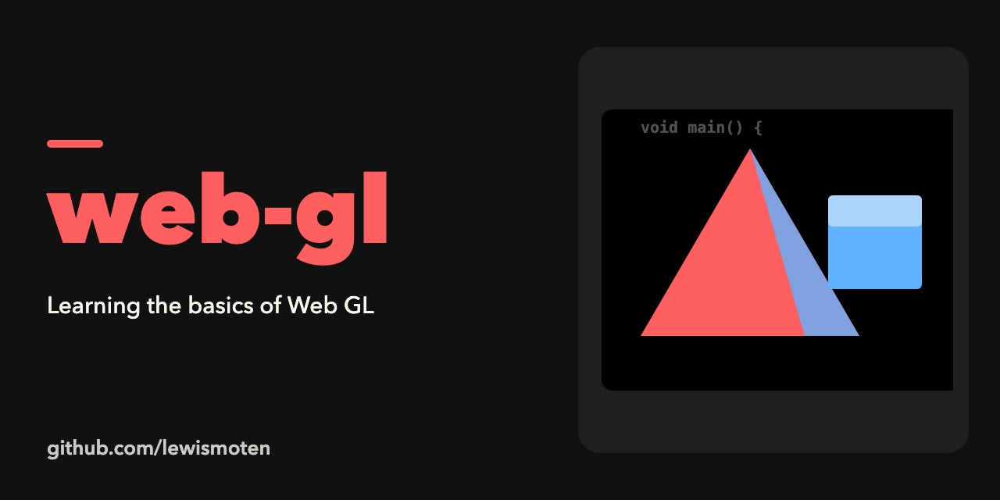

# Web GL

Learning the basics of WebGL. The page draws a triangle and a square, and lets you edit the fragment and vertex shader source in the browser and apply it with the "Update Source Code" button. Matrix math comes from glMatrix 0.9.5 (included).

## Run

Open `index.html` in a browser that supports WebGL.

## Status

A learning experiment from 2015, not maintained.
